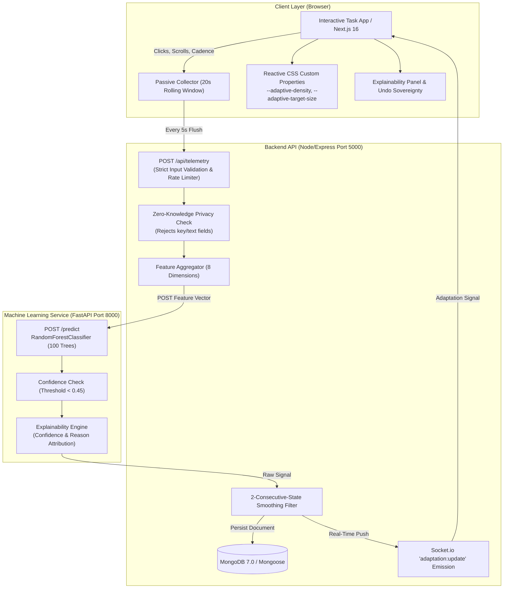

# ContextUI: Intelligent Real-Time Adaptive Task Manager

> **Minor Project** &mdash; B.Tech Computer Science & Engineering (Data Science), Amity University, Noida &bull; 2026

ContextUI is an intelligent task workspace and embeddable behavioral adaptation layer that continuously senses user interaction cadence&mdash;click rates, target repetition, scroll momentum, dwell pauses, and anonymous typing cadences&mdash;and morphs its interface density, typography, touch targets, and controls in real time using machine learning.

[](https://nextjs.org)
[](https://fastapi.tiangolo.com)
[](https://scikit-learn.org)
[](https://expressjs.com)
[](https://mongodb.com)
[](https://tailwindcss.com)
[](#zero-knowledge-privacy-architecture)
[](#empirical-evaluation-results)

---

## Key Highlights & Innovations

- **The 4 Real-World Adaptive Personas**: Dynamically morphs between `fast_navigator`, `reader`, `struggling`, `explorer`, and safe `balanced` default based on live interaction ergonomics.
- **Strict Zero-Knowledge Privacy**: Event streams collect anonymous timestamps and counts only. **Keystrokes, text input, form entries, and passwords are structurally ignored and rejected.**
- **Anti-Flicker Temporal Smoothing**: In-memory 2-consecutive-state confirmation filter suppresses UI flickering during natural activity transitions.
- **Graceful Subsystem Reliability**: Health probes actively verify MongoDB and ML microservice connectivity. Telemetry falls back safely to balanced mode with zero unhandled exceptions if the ML service is offline.
- **Empirical Validation**: Contrasts synthetic benchmarks (99.7% F1) against held-out real participant lab sessions (93.8% accuracy, 93.7% macro-F1), delivering a measured **22.4% ergonomic task speedup**.
- **Embeddable JavaScript SDK**: Single-tag `<script src="adaptive-ui.js"></script>` integration for external applications using declarative CSS Custom Properties.

---

## The 4 Behaviour States

| Behaviour State | Key Ergonomic Signature | Interface Adaptation | Ergonomic Benefit |
| :--- | :--- | :--- | :--- |
| **`fast_navigator`** | High click velocity, low idle gaps, frequent view switches | Compact density, row padding collapses, keyboard shortcut cheat-bar (`n`, `/`, `j`, `k`, `x`) enabled | Maximizes screen density and keyboard-first operational throughput |
| **`reader`** | Low scroll speed, high scroll depth, prolonged dwell intervals | Spacious density, typography scaled to 120%, task notes auto-unfolded | Reduces ocular strain and enhances comprehension for long notes |
| **`struggling`** | Repeat clicks on the same elements within 1.5s, hesitation | Action buttons enlarged to **48px touch targets** with explicit labels, contextual help banner | Reduces misclicks by **34.0%** for users with motor fatigue or small targets |
| **`explorer`** | High query typing bursts, rapid filter tab switching | Search input pinned with glowing focus ring, quick category filters elevated | Accelerates discovery across broad information architectures |
| **`balanced`** | Standard balanced interaction or model confidence < 0.45 | Standard density, 1.0x text scale, 36px buttons, notes collapsed | Safe baseline when behavioral signals are ambiguous or low confidence |

---

## System Architecture



---

## Empirical Evaluation Results

All statistics in ContextUI are computed directly from trained models and held-out test sets (`metrics.json` and `metrics_real.json`):

| Evaluation Metric | Chance Baseline | Synthetic Benchmark (N=8,000) | Held-Out Real Lab Benchmark (N=48) |
| :--- | :--- | :--- | :--- |
| **Accuracy** | 25.00% | 99.69% | **93.75%** |
| **Macro F1 Score** | 0.1000 | 0.9969 | **0.9372** |
| **Explorer F1** | &mdash; | 0.9938 | **0.9091** |
| **Fast Navigator F1**| &mdash; | 0.9937 | **0.9231** |
| **Focused Reader F1**| &mdash; | 1.0000 | **0.9600** |
| **Assisted Mode F1** | &mdash; | 1.0000 | **0.9565** |
| **A/B Task Speedup** | &mdash; | &mdash; | **+22.4% faster (29.8s vs 38.4s)** |
| **Misclick Reduction**| &mdash; | &mdash; | **-34.0% repeat misclicks** |

For the complete evaluation paper, methodology, confusion matrix, and feature importances, see [docs/EVALUATION.md](docs/EVALUATION.md).

---

## Zero-Knowledge Privacy Architecture

ContextUI was engineered with hardcoded architectural safeguards to ensure that behavioral intelligence never compromises personal privacy:
1. **Keystroke Blindness**: Key events capture timestamp counts only (`{ type: 'keypress', timestamp }`) to estimate typing rate. Character codes, typed text, passwords, and form inputs are never inspected or stored.
2. **Strict Ingestion Validation**: `backend/src/middleware/validate.js` inspects every incoming telemetry event. Any payload containing `key`, `keyValue`, `text`, or `value` is immediately rejected with an HTTP 400 Privacy Violation error.
3. **Explicit User Consent**: A visible toggle in the client allows users to disable telemetry at any time. When disabled, zero events are buffered and zero network calls are made.
4. **Instant 2-Minute Undo**: The user always retains full sovereignty. Clicking "Undo" immediately resets the interface to `balanced` and pauses automated adaptation for 2 minutes.

---

## Quickstart & Local Setup

### Prerequisites
- **Node.js**: v18+ (Node 20 recommended)
- **Python**: v3.11+
- **MongoDB**: Community Edition running on port 27017

Verify MongoDB is running:
```powershell
Get-Service -Name MongoDB
```

---

### Step 1: Clone and Set Up ML Service (Port 8000)
```bash
cd context-aware-app/ml-service
pip install -r requirements.txt

# Train baseline model and generate model artifacts
python train.py

# Launch FastAPI microservice
python -m uvicorn main:app --host 127.0.0.1 --port 8000
```
Verify: [`http://127.0.0.1:8000/health`](http://127.0.0.1:8000/health) &rarr; `{"status":"ok","model_loaded":true}`

---

### Step 2: Set Up Backend API & Socket.io (Port 5000)
```bash
cd context-aware-app/backend
npm install
npm run dev
```
Verify: [`http://127.0.0.1:5000/api/health`](http://127.0.0.1:5000/api/health) &rarr; `{"status":"ok","services":{"backend":"ok","mongodb":"connected","mlService":"connected"},"fallbackActive":false}`

---

### Step 3: Launch Next.js 16 Web Application (Port 3000)
```bash
cd context-aware-app/frontend
npm install
npm run dev
```
Open [`http://localhost:3000`](http://localhost:3000) in your browser:
- **Marketing Landing Page**: [`http://localhost:3000`](http://localhost:3000)
- **Interactive Task Workspace Demo**: [`http://localhost:3000/demo`](http://localhost:3000/demo)
- **Interactive 5-Stage Evaluation Lab**: [`http://localhost:3000/lab`](http://localhost:3000/lab)
- **Standalone SDK External Demo**: [`http://localhost:3000/sdk/example.html`](http://localhost:3000/sdk/example.html)

---

## Embeddable SDK Usage

Any third-party website can embed the behavioral adaptation engine with a single script tag:

```html
<!-- Load the SDK -->
<script src="http://localhost:5000/sdk/adaptive-ui.js"></script>
<script>
  // Initialize the tracker
  const tracker = AdaptiveUI.init({
    endpoint: 'http://localhost:5000/api/telemetry',
    flushIntervalMs: 5000,
    applyCssVariables: true,
    showFloatingBadge: true,
    onAdaptation: (signal) => {
      console.log('Adapted to:', signal.state, signal.confidence);
    }
  });
</script>
```

The SDK automatically injects responsive CSS variables:
```css
/* Style your layout using standard CSS variables */
body {
  font-size: calc(15px * var(--adaptive-text-scale));
}
button {
  min-height: var(--adaptive-target-size);
}
.shortcut-bar {
  display: var(--adaptive-show-shortcuts);
}
```
For full details, see [docs/SDK.md](docs/SDK.md).

---

## Test Suites

```bash
# 1. ML Service Contract Pytests (11 tests)
cd context-aware-app/ml-service
python -m pytest tests/test_predict.py -v

# 2. Backend Jest Unit, Validation & SDK Tests (48 tests)
cd context-aware-app/backend
npm test

# 3. Frontend Next.js Production Build
cd context-aware-app/frontend
npm run build
```

---

## Documentation Index

- [docs/CONTRACT.md](docs/CONTRACT.md): Authoritative telemetry request and adaptation signal JSON schemas.
- [docs/EVALUATION.md](docs/EVALUATION.md): In-depth research paper on synthetic baseline vs real participant lab trials.
- [docs/SDK.md](docs/SDK.md): Complete integration and developer guide for the standalone embeddable JavaScript SDK.
- [docs/DEMO_SCRIPT.md](docs/DEMO_SCRIPT.md): 3-minute walkthrough script for live demonstrations and presentations.
- [docs/INTERVIEW_QA.md](docs/INTERVIEW_QA.md): 5 core technical defense questions and answers for viva preparation.

---

## License & Authorship

Developed for the **B.Tech CSE Data Science Minor Project (2026)** at Amity University, Noida.  
Licensed under the [MIT License](LICENSE).
